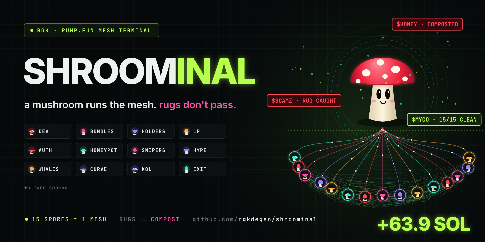
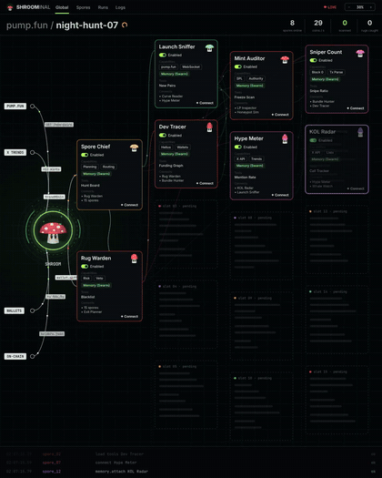

<p align="center">
  
</p>

<h1 align="center">SHROOMINAL</h1>

<p align="center">
  <b>a mushroom runs the mesh. rugs don't pass.</b><br>
  A pump.fun terminal built like mycelium. One core mushroom, <b>SHROOM</b>, wires 15 spores into a single network. Every spore checks one thing, and they all see each other's results.
</p>

<p align="center">
  
  
  
  
  
  
</p>

---

## The idea

Mushrooms have been running a decentralized network for 400 million years. Under every forest there's a mesh of mycelium moving signals between trees. People call it the wood wide web.

Most memecoin bots are a pipeline: check 1, then check 2, then check 3. One check fails and the rest never run, so you never see the whole picture.

SHROOMINAL is a mesh. All 15 spores look at the coin at once and share what they found. If one spore flags it, every spore knows, and Rug Warden vetoes it.

<p align="center">
  
</p>

▶ Full demo: [`assets/demo.mp4`](assets/demo.mp4) · Live terminal: [`terminal/index.html`](terminal/index.html)

---

## How the mesh works

```
 PUMP.FUN ─┐
 X TRENDS ─┤                 ┌─ Spore Chief ── plans the hunt, routes mints
 WALLETS  ─┼──► SHROOM ──────┤
 ON-CHAIN ─┘   (core)        └─ Rug Warden ─── veto on any single flag
                    │
                    ▼
        ┌──── 15 spores, all wired together (mycelium) ────┐
        │  every spore checks · every spore sees the rest  │
        └───────────────────────┬──────────────────────────┘
                                ▼
                 any flag ──► RUG ──► compost
                 all clean ─► PICK ──► Exit Planner + Profit Taker ──► HARVEST
```

| Phase | What happens |
|---|---|
| **CORE** | SHROOM reads four feeds: pump.fun new pairs, X trends, wallets and on-chain txs. |
| **LEADS** | Spore Chief plans the hunt and routes mints. Rug Warden holds the veto. |
| **MESH** | 15 spores check the coin in parallel and share every result over the mycelium. |
| **HUNT** | Each mint becomes a row of tasks (`lp.burn`, `dev.trace`, `bundle.scan`…). One red flag marks it `rug.flag`. |
| **HARVEST** | Clean coins are picked, sized and laddered out. Rugs go to the compost list. |

## The 15 spores

| # | Spore | Check | Flags the coin when… |
|---|---|---|---|
| 1 | **Launch Sniffer** | mint age | it's older than 90s (stale) |
| 2 | **Dev Tracer** | dev wallet + funding graph | the dev holds more than 5%, or already sold more than 10% |
| 3 | **Bundle Hunter** | Jito bundles / clusters | more than 15% of supply was bundled at launch |
| 4 | **Holder Mapper** | holder spread | top 10 hold more than 30%, or fewer than 80 holders |
| 5 | **LP Inspector** | LP burn / lock | the LP isn't burned |
| 6 | **Mint Auditor** | mint / freeze authority | either authority is still live |
| 7 | **Hype Meter** | organic X mentions | fewer than 15 real mentions early |
| 8 | **Curve Reader** | bonding curve fill | the curve is more than 60% full (too late) |
| 9 | **Whale Watch** | fresh big wallets | one fresh wallet holds more than 8% |
| 10 | **Honeypot Sim** | simulated sell | the sell fails or the tax is above 10% |
| 11 | **Sniper Count** | block-0 snipers | snipers took more than 12% in block 0 |
| 12 | **KOL Radar** | paid vs organic calls | more than half the mentions are paid callers |
| 13 | **Volume Scout** | 1m volume spike | volume is flat (under 2× the 5m average) |
| 14 | **Exit Planner** | stop ladder | manages the bag: hard stop at −35% |
| 15 | **Profit Taker** | TP ladder | manages the bag: 40% at 3×, 40% at 10×, 20% moonbag |

Thresholds live in [`src/config.ts`](src/config.ts).

## Rugs the mesh caught

```
$SCAMZ   ✕ Dev Tracer      dev sold 92%
         ✕ Holder Mapper   top10 hold 48%
         → RUG · composted       2 spores flagged

$HONEY   ✕ Mint Auditor    freeze authority ON
         ✕ Honeypot Sim    sell fail · honeypot
         → RUG · composted       "you buy, you never sell"
```

A pipeline stops at the first flag. The mesh shows you every reason at once.

## The one that paid

```
$MYCO    34s old · dev 1.2% · 4% bundled · 212 holders · lp burned · authority revoked
         140 mentions · vol 6.2× · curve 18%
         ✓ PICK  13/13 clean · 1.47 SOL
         ⇡ TP1 3× · 40% out
         ⇡ TP2 10× · 40% out · moonbag rides
```

## Demo night run

| | |
|---|---|
| coins scanned | 1,284 |
| rugs caught before entry | 41 |
| picks | 9 |
| wallet | 4.2 → 68.1 SOL |

> Numbers in the demo video and terminal come from a scripted replay used for the visual. They are not a live trading record.

## Repo layout

```
shroominal/
├── terminal/index.html   # the SHROOMINAL terminal (self-contained, open in a browser, loops)
├── src/
│   ├── config.ts         # spore thresholds, entry size, stop + TP ladder
│   ├── spores.ts         # the 15 spores + sizing
│   ├── mesh.ts           # the mesh: parallel checks → Rug Warden veto → pick + exits
│   └── index.ts          # entry point (dry-run demo)
└── assets/               # banner, preview gif, demo video
```

## Run it

**Terminal (visual):** open `terminal/index.html` in any browser. It runs on its own and loops.

**Mesh skeleton:**

```bash
npm install
cp .env.example .env    # set RPC_URL
npm run dev             # dry-run: logs RUG / PICK decisions, sends no transactions
```

The `src/` mesh is a reference skeleton. Each spore is a typed check you wire to your own data source (RPC, indexer, pump.fun API). It runs in dry-run mode by default.

## Disclaimer

This is not financial advice. Most memecoins are rugs, which is why the compost pile is always growing. No filter catches everything. Never trade with money you can't afford to lose.

---

<p align="center"><sub>the forest has had a network for 400M years. now it trades · built by <b>RGK</b></sub></p>
